# QC report - ai-chip-reveal and chip-ignite

Two reference clips, two Remotion projects, four videos. Every number in this report was measured on the delivered files with the scripts in `qc/` and in each project's `scripts/` folder.

| # | File | What it is |
|---|---|---|
| 1 | `01-V1-ai-chip-reveal.mp4` | Reference A, Version 1 (closest match) |
| 2 | `02-V2-ai-chip-reveal.mp4` | Reference A, Version 2: colour palette changed (amber -> cyan) |
| 3 | `03-V1-chip-ignite.mp4` | Reference B, Version 1 (closest match) |
| 4 | `04-V2-chip-ignite.mp4` | Reference B, Version 2: camera movement changed |
| 5 | `ai-chip-reveal-project.zip`, `chip-ignite-project.zip` | Sources with both 4K compositions each |

## 1. Reference analysis (step 2)

### Reference A - `ai-chip-reveal`

| | |
|---|---|
| Source | `0bb38d88-istockphoto-2094174172-640_adpp_is.mp4`, 768x432, H.264, 24 fps, 241 frames, no audio |
| Duration | **10.041667 s** -> round(10.041667 x 30) = **301 frames** at 30 fps = 10.0333 s (0.0083 s shorter, a quarter of a frame; 24 fps is not a multiple of 30) |
| 2D or 3D | **3D.** The camera orbits a socket with real parallax between the pin field, the socket frame, capacitors and slot bars, the lens has shallow depth of field, and the board then spins a full turn in perspective. None of that survives a 2D treatment. |
| Loops? | **No.** It starts on a close-up and ends on a wide shot. |
| Technology | three.js through `@remotion/three` (React Three Fiber canvas), WebGL 2 via ANGLE. Instanced meshes for the roughly 1,500 parts, a seeded canvas texture for the board, shader ribbons for the glowing traces, pmndrs `postprocessing` for depth of field and bloom, and a custom final pass (ACES tone mapping, grade, grain, dither). The whip uses real motion blur from 6 sub-frame renders. |
| Version 2 | **Colour palette** (amber -> electric cyan). The camera whip and spin are the identity of this piece, so they stay; the amber glow is a single hue family against black and silver, so swapping it reads instantly and changes nothing else. |

**What it shows**

- 0.0-2.1 s: close-up of a pin-grid processor in a socket, glowing "AI" letters with fine circuit lines fanning out. The camera starts about 35-40 degrees off-axis and settles square-on. Chrome capacitors and over-exposed white blocks sit on the left, black slot bars on the right, thick amber traces run under everything.
- 2.1-3.4 s: whip pull-back. The frame blows out to white for about 5 frames (peak near 2.45 s), the board spins a full turn, and its back catches the light once (a second, smaller brightness peak near 2.9 s).
- 3.4-10.0 s: the whole motherboard floats, small, in a dark grey void with a soft pool of light under it. Parts are still drifting into place (an exploded view that closes), the board keeps turning a few degrees and shrinks slowly, and the glow dims towards the end.

**Colours (sampled)**: blacks `#050203`-`#0b0708`; white blocks `#f0f1f4`; amber glow `#b86a1f` with hot parts `#f0a835`, deep amber `#6c3a18`; wide shot backdrop from `#030303` (corner) to `#1a1a1a` (pool under the board); silver parts `#9b999b`-`#cdc9c4`.

**Light, atmosphere, texture**: soft, cool-white studio light from the upper left gives broad gradient reflections on chrome and brushed metal; the only coloured light is the amber of the traces and letters, which spills onto nearby black plastic. Glows are tight (falling to half within about 5% of the frame height in the wide shot) with a faint wide halo. The close-up is soft with shallow focus (foreground capacitors and the right-hand bars are blurred); the wide shot is clean and sharp with a smooth dark gradient and no visible grain (measured 0.01-0.06 levels), while the close-up carries light noise (about 1 level). No fog, dust or rays. Corners in the wide shot are about a fifth of the centre brightness.

### Reference B - `chip-ignite`

| | |
|---|---|
| Source | `162cc20b-istockphoto-2052605052-640_adpp_is.mp4`, 768x432, H.264, 25 fps, 340 frames |
| Duration | **13.600 s** -> 13.6 x 30 = **408 frames** exactly (difference 0) |
| Audio | The file has an AAC track, but it is digital silence (mean and peak -91 dB) and no audio was provided, so the videos have **no audio stream**. |
| 2D or 3D | **3D.** A continuous camera move (orbit, crane up, slight push) over a board covered in parts of different heights, with a chip descending in depth, shadows, and lens blur front and back. |
| Loops? | **No.** It starts unlit and ends fully lit. |
| Technology | three.js through `@remotion/three`, WebGL 2 via ANGLE. A 4096 px seeded canvas texture (three detail scales) for the board, a second for the etched tiles, about 9,000 instanced parts, reveal-masked shader ribbons for the spreading light, an additive flare card, pmndrs `postprocessing` for depth of field and bloom, and the custom final pass (radial colour fringe, vignette, ACES, grade, grain, dither). |
| Version 2 | **Camera movement.** The reference move is slow and gentle over a scene that is detailed in every direction, so a new path (start high and nearly square-on, spiral about 70 degrees around the package while descending and pushing in) shows the same design freshly. A palette change would have weakened the warm-on-neutral contrast that the ignition depends on. |

**What it shows**

- 0.0-5.7 s: a large square package with a 3x3 grid of etched silver tiles sits on a dense black-and-silver board. A small chip descends into the empty centre cell, turning slightly, and seats at about 5.7 s. Four small amber indicator lights (and two red bars) come on at the lower right from about 3.2 s.
- 6.0-6.9 s: the chip glows orange-red, then bursts into a white-hot flare.
- 6.7-13.6 s: amber light runs out along circuit lines on the tiles (about 1.7 s), then on across the board in long straight lines; the flare and the lit tiles keep growing brighter. The camera rises from a low three-quarter view to nearly top-down while orbiting about 15 degrees.

**Colours (sampled)**: black `#010101`; board silver `#a0a29f`-`#c1c0bd`; tiles around `#848484`; amber `#a4784b` to `#dda266`; bronze pins `#664a2c`; about 1% blue-cyan (`#356887`) from chromatic fringing at edges.

**Light, atmosphere, texture**: one hard, slightly cool key from the upper right and behind makes the fine copper pattern sparkle and throws short shadows; large areas (shrouds, package) stay pure black, so the image is very high in contrast (about 40% of pixels below 5%, yet p95 near 0.7). Depth of field blurs the foreground strip and the far background; frame edges show cyan/orange fringing. After ignition the warm glow is local to the package with a small white core and a wide soft amber halo. Texture is extremely dense (Laplacian variance 2,300-3,700, five times reference A) with light noise.

## 2. Look development (step 4A)

`scripts/measure-look.py` (in both projects) reports luminance percentiles, clipped and dark pixel shares, saturation and split-tone hue, glow falloff, haze contrast by region, grain, detail and vignette. All frames are measured at 768x432 with the stock watermark area masked out. Glow radii are fractions of the frame height; `-` means the brightness never falls that far.

### ai-chip-reveal: the reference at five moments (0.5, 1.5, 3.5, 6.0 and 9.5 s)

| Measure | 0.5 s | 1.5 s | 3.5 s | 6.0 s | 9.5 s |
|---|---|---|---|---|---|
| lum_p1 | 0 | 0 | 0.008 | 0.012 | 0.012 |
| lum_p5 | 0.008 | 0 | 0.012 | 0.02 | 0.02 |
| lum_p50 | 0.231 | 0.094 | 0.059 | 0.051 | 0.051 |
| lum_p95 | 0.951 | 0.9 | 0.309 | 0.171 | 0.101 |
| lum_p99 | 0.977 | 0.953 | 0.712 | 0.544 | 0.435 |
| pct_above_90 | 8.89 | 5.017 | 0.493 | 0.198 | 0.128 |
| pct_below_5 | 12.952 | 34.821 | 42.845 | 46.805 | 49.053 |
| sat_mean | 0.251 | 0.353 | 0.052 | 0.064 | 0.057 |
| hue_shadows | 3.6 | 12.8 | 353 | 353 | 8.4 |
| hue_midtones | 23.2 | 28 | 22.3 | 27.2 | 30 |
| hue_highlights | 33.4 | 39.5 | 33.4 | 33.7 | 34 |
| glow_r50 | 0.356 | 0.322 | 0.023 | 0.046 | 0.044 |
| glow_r25 | - | 0.553 | 0.083 | 0.1 | 0.079 |
| glow_r10 | - | - | 0.574 | 0.401 | 0.34 |
| contrast_top | 0.939 | 0.902 | 0.328 | 0.179 | 0.091 |
| contrast_mid | 0.955 | 0.927 | 0.372 | 0.17 | 0.089 |
| contrast_bottom | 0.922 | 0.835 | 0.165 | 0.093 | 0.069 |
| contrast_centre | 0.547 | 0.308 | 0.586 | 0.423 | 0.349 |
| contrast_edge | 0.948 | 0.927 | 0.122 | 0.098 | 0.074 |
| grain_std_8bit | 0.84 | 1.139 | 0.026 | 0.06 | 0.013 |
| detail_lap_var | 323 | 490 | 435 | 488 | 336 |
| vignette_ratio | 1.151 | 1.202 | 0.193 | 0.194 | 0.198 |

### chip-ignite: the reference at five moments (0.5, 4.0, 6.4, 8.4 and 13.0 s)

| Measure | 0.5 s | 4.0 s | 6.4 s | 8.4 s | 13.0 s |
|---|---|---|---|---|---|
| lum_p1 | 0 | 0 | 0 | 0 | 0 |
| lum_p5 | 0 | 0 | 0 | 0 | 0 |
| lum_p50 | 0.063 | 0.114 | 0.115 | 0.177 | 0.199 |
| lum_p95 | 0.69 | 0.73 | 0.678 | 0.723 | 0.753 |
| lum_p99 | 0.79 | 0.808 | 0.769 | 0.84 | 0.863 |
| pct_above_90 | 0.069 | 0.139 | 0.133 | 0.421 | 0.423 |
| pct_below_5 | 47.508 | 39.578 | 38.602 | 32.007 | 28.603 |
| sat_mean | 0.239 | 0.239 | 0.267 | 0.322 | 0.301 |
| hue_shadows | 26.9 | 23.6 | 22 | 20.3 | 23.6 |
| hue_midtones | 67.8 | 65.5 | 51.1 | 32 | 32.5 |
| hue_highlights | 55.4 | 55.9 | 38.3 | 25.8 | 27 |
| glow_r50 | 0.713 | 0.607 | 0.537 | 0.199 | 0.262 |
| glow_r25 | - | 0.685 | 0.741 | - | - |
| glow_r10 | - | - | - | - | - |
| contrast_top | 0.622 | 0.671 | 0.58 | 0.689 | 0.737 |
| contrast_mid | 0.683 | 0.698 | 0.636 | 0.77 | 0.797 |
| contrast_bottom | 0.731 | 0.771 | 0.706 | 0.71 | 0.698 |
| contrast_centre | 0.696 | 0.705 | 0.627 | 0.793 | 0.797 |
| contrast_edge | 0.687 | 0.738 | 0.686 | 0.702 | 0.716 |
| grain_std_8bit | 0.405 | 0.781 | 3.339 | 1.766 | 0.731 |
| detail_lap_var | 2374 | 2649 | 2300 | 2741 | 3676 |
| vignette_ratio | 0.915 | 0.866 | 0.556 | 0.273 | 0.144 |

### ai-chip-reveal: the three look-dev stills (0.5 s, 1.5 s and 6.0 s) against the reference

| Measure | start ref | ours | peak ref | ours | middle ref | ours |
|---|---|---|---|---|---|---|
| lum_p1 | 0 | 0 | 0 | 0 | 0.012 | 0 |
| lum_p5 | 0.008 | 0 | 0 | 0 | 0.02 | 0.012 |
| lum_p50 | 0.231 | 0.215 | 0.094 | 0.184 | 0.051 | 0.051 |
| lum_p95 | 0.951 | 1 | 0.9 | 0.985 | 0.171 | 0.131 |
| lum_p99 | 0.977 | 1 | 0.953 | 1 | 0.544 | 0.589 |
| pct_above_90 | 8.89 | 10.769 | 5.017 | 6.753 | 0.198 | 0.123 |
| pct_below_5 | 12.952 | 11.389 | 34.821 | 21.77 | 46.805 | 47.363 |
| sat_mean | 0.251 | 0.26 | 0.353 | 0.252 | 0.064 | 0.081 |
| hue_shadows | 3.6 | 9.8 | 12.8 | 4.7 | 353 | 7.3 |
| hue_midtones | 23.2 | 21.2 | 28 | 21.5 | 27.2 | 26.6 |
| hue_highlights | 33.4 | 32.4 | 39.5 | 34.6 | 33.7 | 35.4 |
| glow_r50 | 0.356 | 0.465 | 0.322 | 0.276 | 0.046 | 0.032 |
| glow_r25 | - | - | 0.553 | - | 0.1 | 0.106 |
| glow_r10 | - | - | - | - | 0.401 | 0.44 |
| contrast_top | 0.939 | 0.996 | 0.902 | 0.97 | 0.179 | 0.185 |
| contrast_mid | 0.955 | 0.993 | 0.927 | 0.996 | 0.17 | 0.148 |
| contrast_bottom | 0.922 | 1 | 0.835 | 0.982 | 0.093 | 0.11 |
| contrast_centre | 0.547 | 0.617 | 0.308 | 0.58 | 0.423 | 0.485 |
| contrast_edge | 0.948 | 1 | 0.927 | 0.997 | 0.098 | 0.09 |
| grain_std_8bit | 0.84 | 0.606 | 1.139 | 6.504 | 0.06 | 0.225 |
| detail_lap_var | 323 | 383 | 490 | 902 | 488 | 441 |
| vignette_ratio | 1.151 | 1.584 | 1.202 | 1.28 | 0.194 | 0.241 |

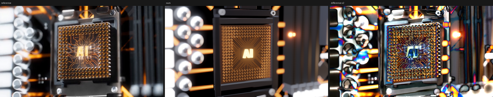

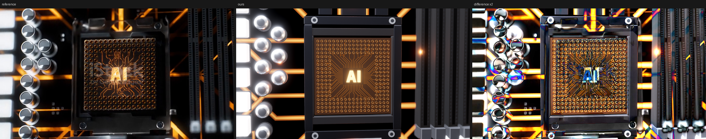

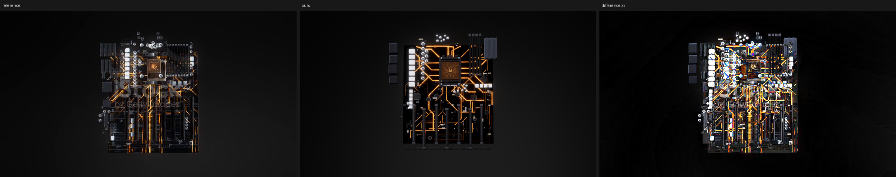

### chip-ignite: the three look-dev stills (0.5 s, 6.4 s and 8.4 s) against the reference

| Measure | start ref | ours | middle ref | ours | peak ref | ours |
|---|---|---|---|---|---|---|
| lum_p1 | 0 | 0 | 0 | 0 | 0 | 0 |
| lum_p5 | 0 | 0 | 0 | 0.001 | 0 | 0.007 |
| lum_p50 | 0.063 | 0.076 | 0.115 | 0.118 | 0.177 | 0.161 |
| lum_p95 | 0.69 | 0.632 | 0.678 | 0.736 | 0.723 | 0.814 |
| lum_p99 | 0.79 | 0.789 | 0.769 | 0.852 | 0.84 | 0.908 |
| pct_above_90 | 0.069 | 0.016 | 0.133 | 0.171 | 0.421 | 1.283 |
| pct_below_5 | 47.508 | 40.562 | 38.602 | 31.298 | 32.007 | 23.9 |
| sat_mean | 0.239 | 0.249 | 0.267 | 0.328 | 0.322 | 0.366 |
| hue_shadows | 26.9 | 10.4 | 22 | 4.7 | 20.3 | 10.5 |
| hue_midtones | 67.8 | 44.7 | 51.1 | 36.5 | 32 | 34 |
| hue_highlights | 55.4 | 62.9 | 38.3 | 49 | 25.8 | 38 |
| glow_r50 | 0.713 | 0.039 | 0.537 | 0.711 | 0.199 | 0.259 |
| glow_r25 | - | 0.745 | 0.741 | - | - | - |
| glow_r10 | - | - | - | - | - | - |
| contrast_top | 0.622 | 0.644 | 0.58 | 0.733 | 0.689 | 0.829 |
| contrast_mid | 0.683 | 0.664 | 0.636 | 0.703 | 0.77 | 0.831 |
| contrast_bottom | 0.731 | 0.591 | 0.706 | 0.765 | 0.71 | 0.776 |
| contrast_centre | 0.696 | 0.587 | 0.627 | 0.639 | 0.793 | 0.883 |
| contrast_edge | 0.687 | 0.644 | 0.686 | 0.76 | 0.702 | 0.776 |
| grain_std_8bit | 0.405 | 1.195 | 3.339 | 1.717 | 1.766 | 2.235 |
| detail_lap_var | 2374 | 1769 | 2300 | 3421 | 2741 | 3652 |
| vignette_ratio | 0.915 | 0.692 | 0.556 | 0.48 | 0.273 | 0.329 |

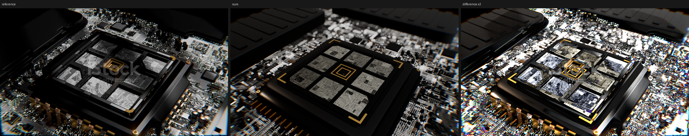

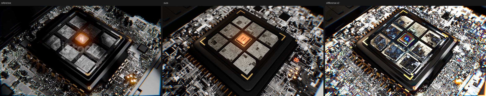

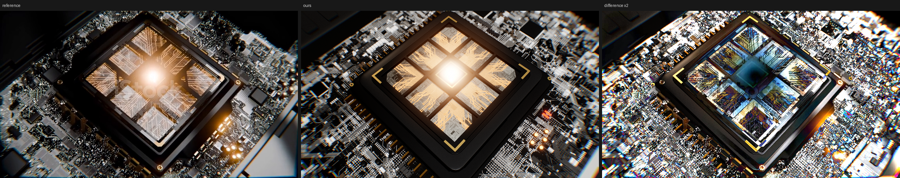

## 3. Look table: each video against its reference over time (step 8A-7)

Five moments per video. `ref` is the reference frame, `ours` the frame of the delivered MP4 at the same time, `diff` = ours - ref. A cross marks a value outside the step 4A target (+-10% of the reference; hues +-10 degrees; small absolute tolerances where 10% of a near-zero value is meaningless, see `qc/look-over-time.py`). For the Version 2 of ai-chip-reveal the hue and saturation measures are skipped, because the palette is what changed. For the Version 2 of chip-ignite all measures are listed for information only: its camera is different on purpose, so the frames are not comparable shot for shot.

**`01-V1-ai-chip-reveal.mp4`** - 76 of 110 values within target

| Measure | 0.5 s ref | ours | diff | 1.5 s ref | ours | diff | 3.5 s ref | ours | diff | 6.0 s ref | ours | diff | 9.5 s ref | ours | diff |
|---|---|---|---|---|---|---|---|---|---|---|---|---|---|---|---|
| lum_p1 | 0 | 0 | 0 | 0 | 0 | 0 | 0.008 | 0 | -0.008 | 0.012 | 0 | -0.012 | 0.012 | 0 | -0.012 |
| lum_p5 | 0.008 | 0 | -0.008 | 0 | 0 | 0 | 0.012 | 0.012 | 0 | 0.02 | 0.012 | -0.008 | 0.02 | 0.016 | -0.004 |
| lum_p50 | 0.231 | 0.211 | -0.02 | 0.094 | 0.179 | 0.085 ✗ | 0.059 | 0.051 | -0.008 | 0.051 | 0.047 | -0.004 | 0.051 | 0.047 | -0.004 |
| lum_p95 | 0.951 | 1 | 0.049 | 0.9 | 0.982 | 0.081 | 0.309 | 0.249 | -0.061 ✗ | 0.171 | 0.128 | -0.044 ✗ | 0.101 | 0.106 | 0.004 |
| lum_p99 | 0.977 | 1 | 0.024 | 0.953 | 1 | 0.047 | 0.712 | 0.712 | 0 | 0.544 | 0.585 | 0.04 | 0.435 | 0.467 | 0.032 |
| pct_above_90 | 8.89 | 10.656 | 1.766 ✗ | 5.017 | 6.702 | 1.685 ✗ | 0.493 | 0.441 | -0.052 | 0.198 | 0.103 | -0.095 | 0.128 | 0.045 | -0.083 |
| pct_below_5 | 12.952 | 11.562 | -1.39 | 34.821 | 21.999 | -12.822 ✗ | 42.845 | 48.37 | 5.525 ✗ | 46.805 | 50.215 | 3.41 | 49.053 | 51.842 | 2.789 |
| sat_mean | 0.251 | 0.269 | 0.018 | 0.353 | 0.263 | -0.09 ✗ | 0.052 | 0.073 | 0.022 | 0.064 | 0.066 | 0.002 | 0.057 | 0.045 | -0.012 |
| hue_shadows | 3.6 | 8.7 | 5.1 | 12.8 | 2 | -10.8 ✗ | 353 | 7.5 | 14.8 ✗ | 353 | 2.3 | 9 | 8.4 | 5.4 | -3 |
| hue_midtones | 23.2 | 20.1 | -3.1 | 28 | 20.1 | -7.9 | 22.3 | 19.7 | -2.6 | 27.2 | 25.7 | -1.5 | 30 | 26 | -4 |
| hue_highlights | 33.4 | 31.2 | -2.2 | 39.5 | 33.4 | -6.1 | 33.4 | 33.7 | 0.3 | 33.7 | 33.6 | -0.1 | 34 | 31.5 | -2.5 |
| glow_r50 | 0.356 | 0.405 | 0.049 ✗ | 0.322 | 0.465 | 0.143 ✗ | 0.023 | 0.065 | 0.042 ✗ | 0.046 | 0.046 | 0 | 0.044 | 0.044 | 0 |
| glow_r25 | - | 0.632 | - ✗ | 0.553 | - | - ✗ | 0.083 | 0.127 | 0.044 | 0.1 | 0.1 | 0 | 0.079 | 0.102 | 0.023 |
| glow_r10 | - | - | - | - | - | - | 0.574 | 0.518 | -0.056 | 0.401 | 0.456 | 0.056 ✗ | 0.34 | 0.38 | 0.039 |
| contrast_top | 0.939 | 0.994 | 0.055 | 0.902 | 0.967 | 0.065 | 0.328 | 0.279 | -0.049 ✗ | 0.179 | 0.185 | 0.006 | 0.091 | 0.082 | -0.01 ✗ |
| contrast_mid | 0.955 | 0.995 | 0.04 | 0.927 | 0.996 | 0.069 | 0.372 | 0.26 | -0.113 ✗ | 0.17 | 0.144 | -0.026 ✗ | 0.089 | 0.114 | 0.025 ✗ |
| contrast_bottom | 0.922 | 1 | 0.078 | 0.835 | 0.978 | 0.144 ✗ | 0.165 | 0.166 | 0.002 | 0.093 | 0.109 | 0.016 ✗ | 0.069 | 0.098 | 0.029 ✗ |
| contrast_centre | 0.547 | 0.613 | 0.066 ✗ | 0.308 | 0.574 | 0.266 ✗ | 0.586 | 0.592 | 0.006 | 0.423 | 0.479 | 0.057 ✗ | 0.349 | 0.375 | 0.025 |
| contrast_edge | 0.948 | 1 | 0.052 | 0.927 | 0.996 | 0.069 | 0.122 | 0.115 | -0.006 | 0.098 | 0.09 | -0.008 | 0.074 | 0.086 | 0.012 ✗ |
| grain_std_8bit | 0.84 | 0.694 | -0.146 | 1.139 | 6.507 | 5.368 ✗ | 0.026 | 0.262 | 0.236 | 0.06 | 0.3 | 0.24 | 0.013 | 0.282 | 0.269 |
| detail_lap_var | 323 | 379 | 56.12 ✗ | 490 | 893 | 403 ✗ | 435 | 416 | -19.2 | 488 | 435 | -53.73 ✗ | 336 | 374 | 38.37 ✗ |
| vignette_ratio | 1.151 | 1.593 | 0.442 ✗ | 1.202 | 1.287 | 0.085 | 0.193 | 0.189 | -0.004 | 0.194 | 0.231 | 0.037 | 0.198 | 0.204 | 0.006 |

**`02-V2-ai-chip-reveal.mp4`** - 62 of 90 values within target

| Measure | 0.5 s ref | ours | diff | 1.5 s ref | ours | diff | 3.5 s ref | ours | diff | 6.0 s ref | ours | diff | 9.5 s ref | ours | diff |
|---|---|---|---|---|---|---|---|---|---|---|---|---|---|---|---|
| lum_p1 | 0 | 0 | 0 | 0 | 0 | 0 | 0.008 | 0 | -0.008 | 0.012 | 0 | -0.012 | 0.012 | 0 | -0.012 |
| lum_p5 | 0.008 | 0 | -0.008 | 0 | 0 | 0 | 0.012 | 0.012 | 0 | 0.02 | 0.012 | -0.008 | 0.02 | 0.016 | -0.004 |
| lum_p50 | 0.231 | 0.209 | -0.022 | 0.094 | 0.176 | 0.082 ✗ | 0.059 | 0.051 | -0.008 | 0.051 | 0.049 | -0.002 | 0.051 | 0.047 | -0.004 |
| lum_p95 | 0.951 | 1 | 0.049 | 0.9 | 0.981 | 0.081 | 0.309 | 0.252 | -0.057 ✗ | 0.171 | 0.135 | -0.036 ✗ | 0.101 | 0.11 | 0.008 |
| lum_p99 | 0.977 | 1 | 0.024 | 0.953 | 1 | 0.047 | 0.712 | 0.737 | 0.024 | 0.544 | 0.618 | 0.074 ✗ | 0.435 | 0.495 | 0.06 ✗ |
| pct_above_90 | 8.89 | 10.692 | 1.802 ✗ | 5.017 | 6.739 | 1.722 ✗ | 0.493 | 0.442 | -0.051 | 0.198 | 0.091 | -0.107 | 0.128 | 0.045 | -0.083 |
| pct_below_5 | 12.952 | 11.397 | -1.555 | 34.821 | 21.93 | -12.891 ✗ | 42.845 | 47.83 | 4.985 | 46.805 | 50.103 | 3.298 | 49.053 | 51.202 | 2.149 |
| glow_r50 | 0.356 | 0.505 | 0.148 ✗ | 0.322 | 0.264 | -0.058 ✗ | 0.023 | 0.046 | 0.023 | 0.046 | 0.032 | -0.014 | 0.044 | 0.06 | 0.016 |
| glow_r25 | - | - | - | 0.553 | - | - ✗ | 0.083 | 0.118 | 0.035 | 0.1 | 0.106 | 0.007 | 0.079 | 0.104 | 0.025 |
| glow_r10 | - | - | - | - | - | - | 0.574 | 0.488 | -0.086 ✗ | 0.401 | 0.444 | 0.044 | 0.34 | 0.38 | 0.039 |
| contrast_top | 0.939 | 0.996 | 0.057 | 0.902 | 0.966 | 0.064 | 0.328 | 0.284 | -0.044 ✗ | 0.179 | 0.191 | 0.012 | 0.091 | 0.09 | -0.001 |
| contrast_mid | 0.955 | 0.994 | 0.04 | 0.927 | 0.996 | 0.069 | 0.372 | 0.273 | -0.1 ✗ | 0.17 | 0.153 | -0.016 | 0.089 | 0.12 | 0.031 ✗ |
| contrast_bottom | 0.922 | 1 | 0.078 | 0.835 | 0.978 | 0.144 ✗ | 0.165 | 0.168 | 0.003 | 0.093 | 0.109 | 0.016 ✗ | 0.069 | 0.101 | 0.033 ✗ |
| contrast_centre | 0.547 | 0.671 | 0.123 ✗ | 0.308 | 0.632 | 0.324 ✗ | 0.586 | 0.619 | 0.033 | 0.423 | 0.511 | 0.088 ✗ | 0.349 | 0.399 | 0.05 ✗ |
| contrast_edge | 0.948 | 1 | 0.052 | 0.927 | 0.996 | 0.069 | 0.122 | 0.116 | -0.006 | 0.098 | 0.09 | -0.008 | 0.074 | 0.086 | 0.012 ✗ |
| grain_std_8bit | 0.84 | 0.722 | -0.118 | 1.139 | 6.292 | 5.153 ✗ | 0.026 | 0.292 | 0.266 | 0.06 | 0.238 | 0.178 | 0.013 | 0.336 | 0.323 |
| detail_lap_var | 323 | 433 | 110 ✗ | 490 | 991 | 501 ✗ | 435 | 420 | -14.62 | 488 | 450 | -38.61 | 336 | 387 | 50.58 ✗ |
| vignette_ratio | 1.151 | 1.531 | 0.379 ✗ | 1.202 | 1.242 | 0.04 | 0.193 | 0.175 | -0.018 | 0.194 | 0.208 | 0.014 | 0.198 | 0.193 | -0.004 |

**`03-V1-chip-ignite.mp4`** - 61 of 110 values within target

| Measure | 0.5 s ref | ours | diff | 4.0 s ref | ours | diff | 6.4 s ref | ours | diff | 8.4 s ref | ours | diff | 13.0 s ref | ours | diff |
|---|---|---|---|---|---|---|---|---|---|---|---|---|---|---|---|
| lum_p1 | 0 | 0 | 0 | 0 | 0 | 0 | 0 | 0 | 0 | 0 | 0 | 0 | 0 | 0 | 0 |
| lum_p5 | 0 | 0 | 0 | 0 | 0 | 0 | 0 | 0.001 | 0.001 | 0 | 0.006 | 0.006 | 0 | 0.009 | 0.009 |
| lum_p50 | 0.063 | 0.072 | 0.009 | 0.114 | 0.092 | -0.021 ✗ | 0.115 | 0.114 | -0.002 | 0.177 | 0.157 | -0.02 ✗ | 0.199 | 0.182 | -0.017 |
| lum_p95 | 0.69 | 0.627 | -0.063 | 0.73 | 0.73 | -0 | 0.678 | 0.732 | 0.053 | 0.723 | 0.809 | 0.086 ✗ | 0.753 | 0.811 | 0.058 |
| lum_p99 | 0.79 | 0.786 | -0.004 | 0.808 | 0.863 | 0.055 | 0.769 | 0.848 | 0.079 ✗ | 0.84 | 0.903 | 0.064 | 0.863 | 0.903 | 0.041 |
| pct_above_90 | 0.069 | 0.015 | -0.054 | 0.139 | 0.183 | 0.044 | 0.133 | 0.141 | 0.008 | 0.421 | 1.095 | 0.674 | 0.423 | 1.13 | 0.707 |
| pct_below_5 | 47.508 | 41.857 | -5.651 ✗ | 39.578 | 35.176 | -4.402 | 38.602 | 32.801 | -5.801 ✗ | 32.007 | 25.42 | -6.587 ✗ | 28.603 | 22.897 | -5.706 ✗ |
| sat_mean | 0.239 | 0.242 | 0.003 | 0.239 | 0.274 | 0.035 ✗ | 0.267 | 0.327 | 0.059 ✗ | 0.322 | 0.36 | 0.038 ✗ | 0.301 | 0.375 | 0.073 ✗ |
| hue_shadows | 26.9 | 10.8 | -16.1 ✗ | 23.6 | 0.4 | -23.2 ✗ | 22 | 4.6 | -17.4 ✗ | 20.3 | 10 | -10.3 ✗ | 23.6 | 12 | -11.6 ✗ |
| hue_midtones | 67.8 | 39.3 | -28.5 ✗ | 65.5 | 37.5 | -28 ✗ | 51.1 | 34.3 | -16.8 ✗ | 32 | 30.5 | -1.5 | 32.5 | 31.5 | -1 |
| hue_highlights | 55.4 | 57 | 1.6 | 55.9 | 56.2 | 0.3 | 38.3 | 46.4 | 8.1 | 25.8 | 36.7 | 10.9 ✗ | 27 | 36.8 | 9.8 |
| glow_r50 | 0.713 | 0.039 | -0.674 ✗ | 0.607 | 0.053 | -0.553 ✗ | 0.537 | 0.711 | 0.174 ✗ | 0.199 | 0.259 | 0.06 ✗ | 0.262 | 0.262 | 0 |
| glow_r25 | - | 0.745 | - ✗ | 0.685 | - | - ✗ | 0.741 | - | - ✗ | - | - | - | - | - | - |
| glow_r10 | - | - | - | - | - | - | - | - | - | - | - | - | - | - | - |
| contrast_top | 0.622 | 0.64 | 0.019 | 0.671 | 0.773 | 0.103 ✗ | 0.58 | 0.729 | 0.149 ✗ | 0.689 | 0.826 | 0.138 ✗ | 0.737 | 0.788 | 0.051 |
| contrast_mid | 0.683 | 0.659 | -0.024 | 0.698 | 0.686 | -0.012 | 0.636 | 0.697 | 0.061 | 0.77 | 0.824 | 0.054 | 0.797 | 0.84 | 0.043 |
| contrast_bottom | 0.731 | 0.586 | -0.146 ✗ | 0.771 | 0.719 | -0.052 | 0.706 | 0.761 | 0.055 | 0.71 | 0.77 | 0.06 | 0.698 | 0.786 | 0.088 ✗ |
| contrast_centre | 0.696 | 0.584 | -0.113 ✗ | 0.705 | 0.64 | -0.065 | 0.627 | 0.633 | 0.006 | 0.793 | 0.876 | 0.083 ✗ | 0.797 | 0.874 | 0.077 |
| contrast_edge | 0.687 | 0.639 | -0.048 | 0.738 | 0.742 | 0.004 | 0.686 | 0.755 | 0.069 | 0.702 | 0.772 | 0.07 ✗ | 0.716 | 0.787 | 0.071 |
| grain_std_8bit | 0.405 | 1.287 | 0.882 ✗ | 0.781 | 1.489 | 0.708 ✗ | 3.339 | 1.765 | -1.574 ✗ | 1.766 | 2.195 | 0.429 | 0.731 | 1.748 | 1.017 ✗ |
| detail_lap_var | 2374 | 1735 | -639 ✗ | 2649 | 2895 | 246 | 2300 | 3428 | 1128 ✗ | 2741 | 3551 | 810 ✗ | 3676 | 5212 | 1535 ✗ |
| vignette_ratio | 0.915 | 0.688 | -0.227 ✗ | 0.866 | 0.538 | -0.328 ✗ | 0.556 | 0.479 | -0.077 ✗ | 0.273 | 0.327 | 0.054 ✗ | 0.144 | 0.345 | 0.201 ✗ |

**`04-V2-chip-ignite.mp4`** - 66 of 110 values within target

| Measure | 0.5 s ref | ours | diff | 4.0 s ref | ours | diff | 6.4 s ref | ours | diff | 8.4 s ref | ours | diff | 13.0 s ref | ours | diff |
|---|---|---|---|---|---|---|---|---|---|---|---|---|---|---|---|
| lum_p1 | 0 | 0 | 0 | 0 | 0 | 0 | 0 | 0 | 0 | 0 | 0 | 0 | 0 | 0 | 0 |
| lum_p5 | 0 | 0 | 0 | 0 | 0.001 | 0.001 | 0 | 0 | 0 | 0 | 0 | 0 | 0 | 0 | 0 |
| lum_p50 | 0.063 | 0.082 | 0.019 | 0.114 | 0.094 | -0.02 | 0.115 | 0.091 | -0.024 ✗ | 0.177 | 0.11 | -0.067 ✗ | 0.199 | 0.125 | -0.074 ✗ |
| lum_p95 | 0.69 | 0.697 | 0.007 | 0.73 | 0.736 | 0.006 | 0.678 | 0.716 | 0.038 | 0.723 | 0.799 | 0.075 ✗ | 0.753 | 0.818 | 0.065 |
| lum_p99 | 0.79 | 0.826 | 0.035 | 0.808 | 0.861 | 0.053 | 0.769 | 0.85 | 0.081 ✗ | 0.84 | 0.884 | 0.045 | 0.863 | 0.914 | 0.051 |
| pct_above_90 | 0.069 | 0.019 | -0.05 | 0.139 | 0.346 | 0.207 | 0.133 | 0.177 | 0.044 | 0.421 | 0.498 | 0.077 | 0.423 | 1.414 | 0.991 |
| pct_below_5 | 47.508 | 42.231 | -5.277 ✗ | 39.578 | 32.945 | -6.633 ✗ | 38.602 | 33.89 | -4.712 | 32.007 | 30.618 | -1.389 | 28.603 | 30.325 | 1.722 |
| sat_mean | 0.239 | 0.241 | 0.002 | 0.239 | 0.262 | 0.023 | 0.267 | 0.307 | 0.04 ✗ | 0.322 | 0.351 | 0.029 | 0.301 | 0.372 | 0.071 ✗ |
| hue_shadows | 26.9 | 354 | -32.8 ✗ | 23.6 | 356 | -28.1 ✗ | 22 | 6.3 | -15.7 ✗ | 20.3 | 12.9 | -7.4 | 23.6 | 18 | -5.6 |
| hue_midtones | 67.8 | 41 | -26.8 ✗ | 65.5 | 40.1 | -25.4 ✗ | 51.1 | 36.3 | -14.8 ✗ | 32 | 31.6 | -0.4 | 32.5 | 29.9 | -2.6 |
| hue_highlights | 55.4 | 65.8 | 10.4 ✗ | 55.9 | 56.4 | 0.5 | 38.3 | 51.3 | 13 ✗ | 25.8 | 35.2 | 9.4 | 27 | 35.7 | 8.7 |
| glow_r50 | 0.713 | - | - ✗ | 0.607 | 0.053 | -0.553 ✗ | 0.537 | 0.743 | 0.206 ✗ | 0.199 | 0.257 | 0.058 ✗ | 0.262 | 0.296 | 0.035 ✗ |
| glow_r25 | - | - | - | 0.685 | 0.741 | 0.056 | 0.741 | - | - ✗ | - | - | - | - | - | - |
| glow_r10 | - | - | - | - | - | - | - | - | - | - | - | - | - | - | - |
| contrast_top | 0.622 | 0.707 | 0.085 ✗ | 0.671 | 0.746 | 0.076 ✗ | 0.58 | 0.752 | 0.172 ✗ | 0.689 | 0.8 | 0.111 ✗ | 0.737 | 0.762 | 0.026 |
| contrast_mid | 0.683 | 0.67 | -0.013 | 0.698 | 0.731 | 0.033 | 0.636 | 0.709 | 0.072 ✗ | 0.77 | 0.832 | 0.062 | 0.797 | 0.879 | 0.082 ✗ |
| contrast_bottom | 0.731 | 0.706 | -0.026 | 0.771 | 0.724 | -0.047 | 0.706 | 0.689 | -0.017 | 0.71 | 0.737 | 0.026 | 0.698 | 0.722 | 0.024 |
| contrast_centre | 0.696 | 0.634 | -0.062 | 0.705 | 0.675 | -0.03 | 0.627 | 0.655 | 0.028 | 0.793 | 0.861 | 0.067 | 0.797 | 0.892 | 0.095 ✗ |
| contrast_edge | 0.687 | 0.713 | 0.025 | 0.738 | 0.745 | 0.007 | 0.686 | 0.732 | 0.046 | 0.702 | 0.723 | 0.021 | 0.716 | 0.722 | 0.006 |
| grain_std_8bit | 0.405 | 1.102 | 0.697 ✗ | 0.781 | 1.364 | 0.583 ✗ | 3.339 | 1.113 | -2.226 ✗ | 1.766 | 1.111 | -0.655 ✗ | 0.731 | 1.103 | 0.372 |
| detail_lap_var | 2374 | 3210 | 836 ✗ | 2649 | 3625 | 976 ✗ | 2300 | 3058 | 758 ✗ | 2741 | 2290 | -451 ✗ | 3676 | 1818 | -1858 ✗ |
| vignette_ratio | 0.915 | 1.24 | 0.325 ✗ | 0.866 | 0.739 | -0.128 ✗ | 0.556 | 0.397 | -0.159 ✗ | 0.273 | 0.205 | -0.067 ✗ | 0.144 | 0.316 | 0.172 ✗ |

**Summary.** Inside the target: `01-V1-ai-chip-reveal` 76 of 110 values, `02-V2-ai-chip-reveal` 62 of 90 (hue and saturation skipped), `03-V1-chip-ignite` 61 of 110, `04-V2-chip-ignite` 66 of 110 (for information). So the step 4A target of every measure within +-10% is **not fully met**. For ai-chip-reveal V1 the measures inside the target at all five moments are lum_p1, lum_p5, lum_p99, hue_midtones, hue_highlights; the ones outside at most moments are glow_r50, contrast_mid, contrast_bottom, contrast_centre, detail_lap_var. For chip-ignite V1 the ones inside at all five moments are lum_p1, lum_p5, pct_above_90, glow_r10, contrast_mid; the ones outside at most moments are pct_below_5, sat_mean, hue_shadows, hue_midtones, glow_r50, glow_r25, contrast_top, grain_std_8bit, detail_lap_var, vignette_ratio. The causes are described in section 9. Two measures need care when reading the tables: `glow_r50` follows the brightest element of the frame, which is a different object in the two clips before the flare ignites, and `vignette_ratio` compares corner and centre brightness, which depends on what happens to sit in the corners.

**Stability over time** (`qc/temporal.py`: largest frame-to-frame step of each quantity, measured on every frame; for ai-chip-reveal the intended flash and whip, frames 60-112, are left out):

| Video | Median luminance | p95 luminance | Edge contrast (haze) | Grain level (8-bit) |
|---|---|---|---|---|
| `01-V1-ai-chip-reveal.mp4` | 0.0196 | 0.0039 | 0.0039 | 0.126 |
| `02-V2-ai-chip-reveal.mp4` | 0.0196 | 0.0039 | 0.0039 | 0.152 |
| `03-V1-chip-ignite.mp4` | 0.0039 | 0.0118 | 0.0039 | 0.083 |
| `04-V2-chip-ignite.mp4` | 0.0078 | 0.0118 | 0.0039 | 0.059 |

Luminance values are on a 0-1 scale, so the largest step anywhere is 2% of full scale: light, haze and grain do not flicker or jump.

## 4. Technical checks (step 8A)

| File | Size | Codec | Pixel fmt | fps | Frames | Duration (s) | Reference (s) | Diff (s) | Audio | Decode | Black | Frozen | Flicker |
|---|---|---|---|---|---|---|---|---|---|---|---|---|---|
| `01-V1-ai-chip-reveal.mp4` | 1920x1080 | h264 | yuv420p | 30/1 | 301 | 10.0333 | 10.0417 | -0.0083 | none | pass | pass | pass | pass |
| `02-V2-ai-chip-reveal.mp4` | 1920x1080 | h264 | yuv420p | 30/1 | 301 | 10.0333 | 10.0417 | -0.0083 | none | pass | pass | pass | pass |
| `03-V1-chip-ignite.mp4` | 1920x1080 | h264 | yuv420p | 30/1 | 408 | 13.6000 | 13.6000 | +0.0000 | none | pass | pass | pass | pass |
| `04-V2-chip-ignite.mp4` | 1920x1080 | h264 | yuv420p | 30/1 | 408 | 13.6000 | 13.6000 | +0.0000 | none | pass | pass | pass | pass |

| # | Check | Result | Measured |
|---|---|---|---|
| 1 | Specs: 1920x1080, h264, yuv420p, 30/1 fps, frame count, no audio | **Pass** (4 of 4) | see table above; 301 frames for ai-chip-reveal, 408 for chip-ignite |
| 2 | Duration within one frame of the reference | **Pass** | ai-chip-reveal 10.0333 s against 10.0417 s (-0.0083 s); chip-ignite 13.6000 s against 13.6000 s |
| 3 | Integrity: full decode with `ffmpeg -v error ... -f null -` | **Pass** | no errors or warnings on any file |
| 4 | Frame scan: black frames, frozen runs, flicker (every frame, `qc/verify.py`) | **Pass** | no black frames (lowest frame mean 0.033 / 0.033 / 0.167 / 0.216 on a 0-1 scale), no repeated frames, no flicker. ai-chip-reveal has two intended brightness peaks, the white-out flash (frame 70, 2.33 s) and the glint of the board's back during the spin (frame 87, 2.9 s); the reference has the same two peaks at 2.4 s and 3.0 s. Largest frame-to-frame brightness step in chip-ignite: 0.0056 |
| 5 | Loop | **Not applicable** | neither reference loops (A ends on a different shot, B ends lit), so neither composition loops |
| 6 | Determinism: cold-start frame equals the same frame from a running render, byte for byte (PNG, 1920x1080) | **Pass** (5 of 5) | `V1-ai-chip-reveal` frame 150: `2c7a6c29ecbb17ee...` = `2c7a6c29ecbb17ee...`; `V2-ai-chip-reveal` frame 150: `37e14d983bdcfc3e...` = `37e14d983bdcfc3e...`; `V1-ai-chip-reveal` frame 80: `664271ee52256d56...` = `664271ee52256d56...`; `V1-chip-ignite` frame 204: `ecabb1c2dc9dd706...` = `ecabb1c2dc9dd706...`; `V2-chip-ignite` frame 204: `dc62aac4c1fb68f3...` = `dc62aac4c1fb68f3...`. The motion-blurred frame 80 is included. This check found two real defects during the work (listed under this table), both fixed |
| 7 | Look over time against the step 4A targets | **Not fully met** | 76 of 110 / 62 of 90 / 61 of 110 / 66 of 110 values inside +-10% (section 3). Light, haze and grain are steady: largest frame-to-frame step 0.02 of full scale |
| 8 | Banding and artefacts (levels x4) | **Pass** | no visible steps in the dark gradients of either film, no texture seams (one board plane, no tiling), fine lines anti-aliased with 4x MSAA. The first encode did band: x264 smoothed the dither away (mean pixel-to-pixel step in the backdrop 0.04 levels against 0.31 in the PNG frames). `remotion.config.ts` now adds x264 settings that keep it (0.26 levels in the delivered file) |
| 9 | ZIP test | **Pass** | section 7 |
| 10 | Visual match by fresh sub-agents | Done | Version 1: three rounds each (the maximum). Version 2: see section 6 |
| 11 | Version 2 distinct from Version 1 at a glance, same design | **Pass** | section 5 |

**Defects the checks caught (all fixed before the final renders):**

- *Stale shadow maps* (determinism check): React Three Fiber switched the renderer's shadow maps off again after the first frame, so shadows froze at whatever frame a browser tab started on, and a frame's pixels depended on render history. Shadows are now enabled through the canvas itself.
- *First frame at the wrong internal size* (determinism check): the pipeline read the pixel ratio back from the renderer before it had been applied. It now takes its size from the composition and the render scale.
- *Half-resolution internals* (4K against 1080p comparison): the post-processing composer applied the pixel ratio twice, so `--scale=0.5` renders were computed at 960x540 and upscaled. Buffers are now sized in device pixels and depth of field scales with the frame.
- *Inside-out lathe geometry* (look review): capacitor cans and pin rings shaded black.
- *Banding in the encode* (x4 check): see check 8.

Contact sheet, one frame per second - `01-V1-ai-chip-reveal.mp4`:

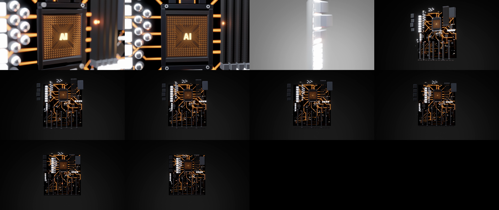

Contact sheet, one frame per second - `02-V2-ai-chip-reveal.mp4`:

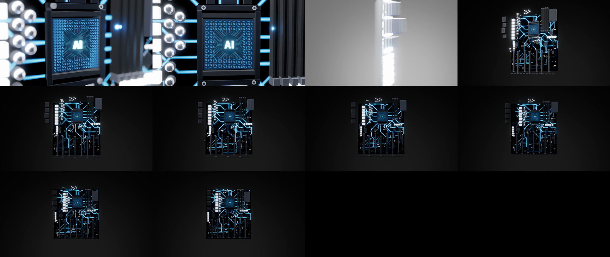

Contact sheet, one frame per second - `03-V1-chip-ignite.mp4`:

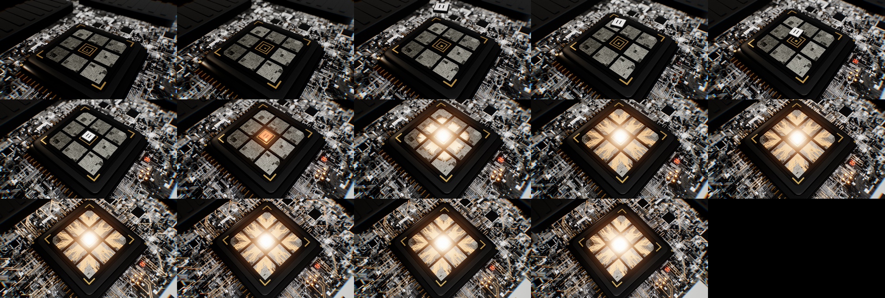

Contact sheet, one frame per second - `04-V2-chip-ignite.mp4`:

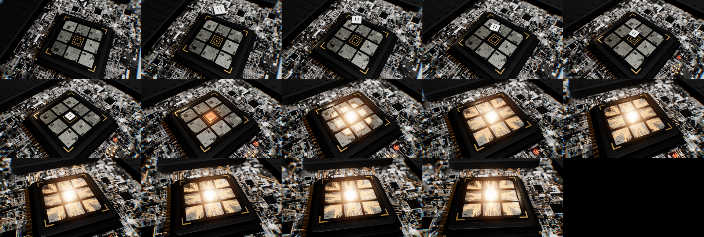

Dark gradient of ai-chip-reveal with levels stretched x4 (frame at 6.0 s of the delivered MP4):

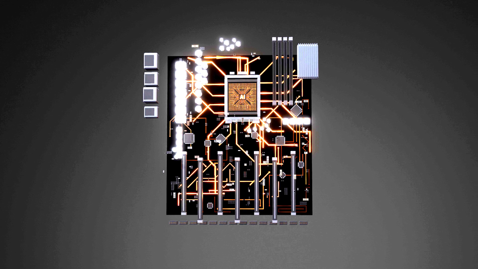

## 5. Version 2 distinctness (step 8B-11)

Version 1 on top, Version 2 below, same times.

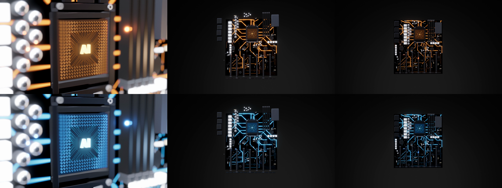

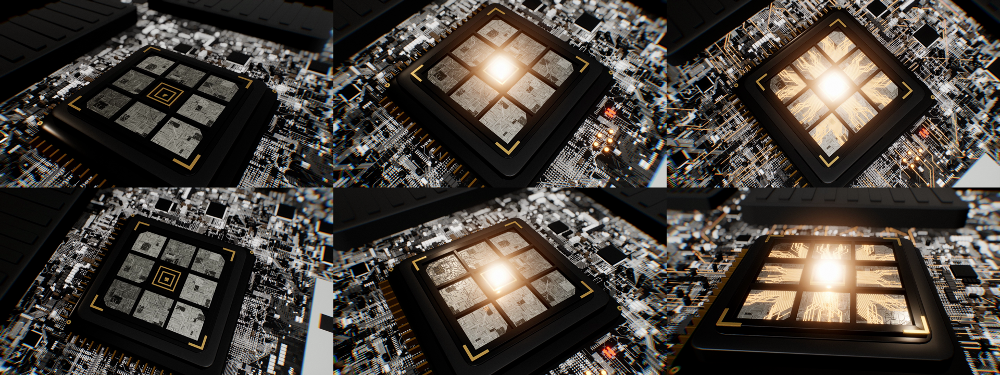

**ai-chip-reveal**: the two versions are the same film frame for frame; only the glow hue differs (amber against cyan), and the overall brightness is the same (mean level of frame 45: 69.7 against 69.5). **chip-ignite**: the same scene, light and timings; Version 1 rises from a low three-quarter view to nearly top-down, Version 2 starts high and comes down around the package to a lower, closer view. Both differences read at a glance, and each pair is obviously the same design.

## 6. Independent reviews and what was fixed

Every review was done by a fresh sub-agent that saw only the image pairs or frame sets named in the brief, with the brief's instruction text.

### Look checks on the three look-dev stills (step 4A-5)

**ai-chip-reveal**

| Round | Main notes | Fixed |
|---|---|---|
| 1 | Attempt too sharp, no depth of field; pure blacks with no haze; glowing lines hard, uniform "emissive strips" with tight halos; capacitors flat white discs; orange too saturated and yellow; wide shot board too bright with clipped white blocks; no grain | Depth of field added, stronger at the angled start; two-layer bloom (tight core, wide halo) with configurable sizes; brightness variation along each line; dome-topped metal cans; palette shifted to deeper amber; white parts and key light held back in the wide shot; film grain pass |
| 2 | Capacitors and socket frame matte black with only a rim crescent, no reflections; traces still too bright and uniform; "AI" white-hot; slot bars too bright; white blocks dominate the wide shot; background flatter | Found and fixed a real defect: the lathe profiles of the cans and pin rings were inside-out, so they shaded black. Trace and letter intensity lowered; separate non-reflective material for the slot bars; backdrop pool retuned; wide-shot exposure and white level lowered |
| 3 | Reference has orange light bouncing onto black plastic and pooling between the slots; pin grid too bright and yellow so the "AI" does not dominate; needs slightly lifted warm shadows; whites harder-edged than the reference | Coloured spill lights raised and extra pool lights added over the lower board; pins darkened to copper on a brown chip face; extruded metal letters; bloom core widened. (Remaining: the reference's milky haze in the close-up is stronger than ours.) |

**chip-ignite**

| Round | Main notes | Fixed |
|---|---|---|
| 1 | Attempt warmer overall (cream traces, saturated copper) where the reference is neutral-cool silver; light flat and frontal instead of a hard key from the upper right; tiles too contrasty; glow at the centre pink with a hard edge; gold accents too orange; hard black void instead of a soft vignette | Light, environment and board texture made neutral; key moved and hardened; tile texture softened; chip glow recoloured deep orange-red; gold and bronze muted; vignette recentred and softened; flare rebuilt with a small core and wide halo |
| 2 | Tiles too dim and flat (reference bright silver with raking gradient); board too dark with no mid-tones; fringing only at the corners; glow too saturated at the peak, veil missing; LEDs too small and orange | Tiles brightened and made more reflective; board mid-tones lifted; fringe widened; glow and halo made paler and wider; LEDs enlarged; grain raised |
| 3 | Board whites clip to blocky white; blacks on the housing milky; attempt now softer than the reference with too much fringe; bloom too large and cream; LEDs over-bloomed | Board highlight level lowered; glossier, deeper blacks on the package; depth of field and fringe reduced; bloom tightened and made more orange; LEDs reduced. (Remaining: the reference's fine "glitter" speculars are finer than our texture.) |

### Visual match of the videos (step 8B)

**01-V1-ai-chip-reveal**

| Round | Main notes | Fixed |
|---|---|---|
| 1 | The reference board is still assembling at 5.0 s (parts floating off the left edge and above) and keeps changing until the end, the attempt is a finished static rectangle; socket should be grey metal; pins flat orange; heavy grainy bokeh discs in the opening; board reads flat and top-down | Added the assembly beat: 15 groups of parts lift off during the spin and settle on their own schedules; board tilt in the wide shot; grey metal socket frame; extruded letters; lower-half layout changed to long parallel slots with a heat sink; cans clustered. Also found and fixed that shadow maps went stale after the first frame |
| 2 | Wide shot evenly lit with every trace the same orange, reference has only some traces glowing; assembly finishes too early; board too tilted; pin field should be dense rings with a small trace area; opening too tight and too blurred; chip too large and legible in the wide shot | Per-line brightness selection in the wide shot (a few bright, most dim); assembly windows moved later and offsets enlarged; tilt reduced; pin ring widened; opening reframed with less blur; letters dimmed and the chip face lit as one copper square in the wide shot |
| 3 | Reference dims towards the end, attempt stays bright; board a little large at 5.0 s; socket frame should read as metal; pins large and saturated; whites pure and bright | End fade-down of traces and pool lights; camera further back from 3.7 s; frame lightened then balanced against the look measures; pins smaller and darker; white level lowered |
| final check | Size, position, timing and empty space "closely matched" (board 36% of frame width at 5.0 s and 29% at 9.8 s in both). Still different: socket frame reads matte black rather than brushed silver; deeper blacks, higher contrast and cleaner edges than the hazy reference; traces thicker, brighter and more saturated, covering more of the board; pin field a more uniform orange; board silhouette tidier at 5.0 s; "AI" legible in the wide shot; an orange bokeh orb right of the chip at 0.3 s that the reference lacks. Verdict: "reads as the same piece of motion design in composition and timing, but as a cleaner, more saturated, less photoreal rendition" | no further changes (three rounds used) |

**03-V1-chip-ignite**

| Round | Main notes | Fixed |
|---|---|---|
| 1 | Camera move far weaker than the reference (which goes from low oblique to near top-down, the chip filling the frame height); final frame lacks energy (reference tiles nearly blown out, long gold traces across the board); large empty matte panels; package a thin flat slab without the gold fin rows; flat centre emblem; tiles dim with coarse patterns; board made of large blocky rectangles | Camera path rebuilt (elevation 38 to 72 degrees, push in at mid-film); glow, tile light and flare now keep building to the end; shrouds smaller, darker and ridged; package made taller in three steps with rows of upright gold fins and solid corner brackets; raised seat rings; finer tile and board textures with glitter specks |
| 2 | Board now too white and busy; final frame flooded with long saturated orange lines to the frame edges (reference: sparse, short, paler gold); flare already a hard white square at 6.8 s with no build-up; chip smaller in frame at the end; red indicator bars missing | Board brightness and pour count reduced; board lines halved, shortened and recoloured pale gold; flare core now grows from 30% to full over the second half; end framing closer; two red bars added next to five LEDs; three more tiles given cut corners |
| 3 | Timing and the indicator lights match and "nothing from the reference is missing outright". Lit state too neutral (reference turns amber, tiles tinted peach); flare a hard-edged white-pink square with almost no halo (reference: soft bloom with a wide orange halo, 13% of frame width growing to 20%); chip too large in frame at 6.8 s and 13.3 s (72-74% of width against 59%) and still oblique at 6.8 s; tiles too bright before ignition; less fringing; flat centre emblem; coarser board detail. Verdict: "clearly reads as the same piece of motion design, but as a cooler, tighter, harder-edged version lacking the reference's warm bloom" | Flare rebuilt with a larger soft core, a mid glow and a wide amber halo that hides the chip face; glow, board-line and ignition-light colours moved back towards orange and the ignition light raised so the tiles pick up a peach tint; camera further back at mid-film and at the end and steeper at 6.8 s; tiles dimmed before ignition; fringe increased. Checked on stills against the reference (this was the third and last round, so no further review). Not changed: centre emblem and board detail scale |

**Version 2 checks**

| Video | Is the change clearly visible? | Everything else the same concept and quality? | Notes |
|---|---|---|---|
| 02-V2-ai-chip-reveal (palette) | **Yes** - "orange/gold accents are unmistakably replaced by cyan/blue with white highlights in all three frames" | **Yes** - "staging, framing, timing and background match closely" | The reviewer noted two things specific to Version 2: the pin field blown out to white, and a leftover brown chip face. Both were fixed afterwards (the chip face is now part of the palette and the cyan pin colour was darkened to the same brightness as the copper one: mean frame brightness 69.5 against 69.7 in Version 1) and Version 2 was rendered again. Its other notes (trace distribution, materials, sharpness) apply equally to Version 1 and are listed there |
| 04-V2-chip-ignite (camera movement), first path | **Yes** - "the reference goes from oblique to a top-down rotated diamond, while the attempt goes from near top-down to a low-angle close-up" | **No** - "the concept and timing match, but the white slab, lifted blacks, coarser board and missing gold spread make it visibly different and less polished" | The first Version 2 path orbited to the side where a large white plate fills the background and the dark shrouds are behind the camera. Fixed by rerouting the move (same idea, orbiting the other way round) so the shrouds stay behind the package and the plate is only a sliver at the frame edge, as in Version 1; the descending chip now also enters from the top instead of starting in frame |
| 04-V2-chip-ignite (camera movement), second path | **Yes** - "the reference ends in a rotated near-top-down view, while the attempt ends in a low, front-on close-up" | **No** - "the concept and timing are the same, but the paler glow, lifted blacks, coarser board and weaker trace spread put it slightly below the reference" | The white slab was gone except for a sliver at 0.3 s. Remaining notes specific to this path: heavy background blur and a plain dark bezel filling the bottom fifth of the last frame, housing at the top lifted to dark grey, LEDs cut off at the frame edge. Fixed by ending the move higher and further back (44 degrees and 27 cm instead of 34 degrees and 23 cm) and starting slightly left, which also brings the spreading board lines into view |
| 04-V2-chip-ignite (camera movement), final path (third and last attempt) | **Yes** - "the reference rolls into a near top-down view with the chip as a diamond, while the attempt pushes into a low, front-on view" | **Yes** - "same concept and comparable polish, though the attempt's chip is flatter and its glow whiter and larger" | Remaining notes are the ones Version 1 shares: flatter package and uniform tiles, flat centre emblem, glow larger and whiter at 6.8 s, thicker and more saturated lit traces without node dots on the board, blockier board with fewer capacitors, stronger edge blur and fringing |

## 7. ZIP test (step 8A-9)

Both final ZIPs were extracted into an empty folder, installed with `npm ci` (0 vulnerabilities reported, no missing files) and one 4K frame of each composition was rendered with the README's `npx remotion still ... --scale=1 --gl=angle` commands:

| Frame | Size | Mean level (0-255) |
|---|---|---|
| `ai-chip-reveal/out/V1-frame-150.png` | 3840x2160 | 20.3 |
| `ai-chip-reveal/out/V2-frame-150.png` | 3840x2160 | 20.6 |
| `chip-ignite/out/V1-frame-252.png` | 3840x2160 | 78.6 |
| `chip-ignite/out/V2-frame-252.png` | 3840x2160 | 72.3 |

**Pass.** The ZIPs contain the source with both 4K compositions, `package.json` and `package-lock.json` (all versions pinned exactly), the Remotion config, the installed skills, the two Python tools and the README. They leave out `node_modules`, `.git`, `out/` and anything holding reference footage (the look-dev comparison sheets are shipped next to this report instead). There are no fonts, models or texture files: everything is generated in code.

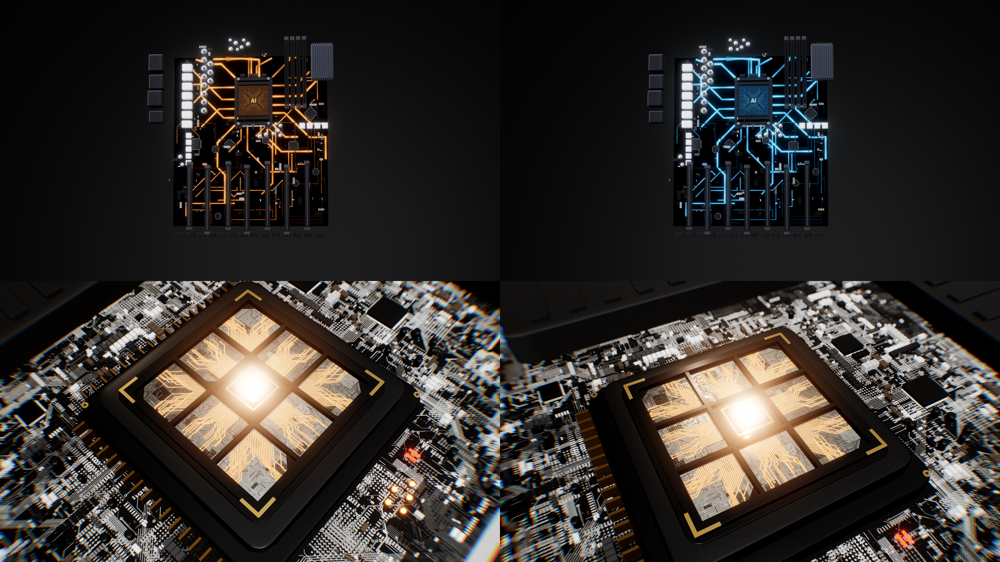

The delivered MP4s were also compared with frames rendered from the packaged source: 41 dB PSNR for ai-chip-reveal, and for chip-ignite 31 dB at full size rising to 45 dB at quarter size, which is H.264 noise on its very dense detail and not a difference in content.

## 8. Render times

Measured on the build machine: 4 CPU cores, no GPU (software WebGL through ANGLE/SwiftShader), default concurrency. Some renders shared the CPU with QC jobs, so treat the totals as upper bounds; a machine with a GPU will be many times faster.

| Video | Frames | 1080p total (measured) | 1080p per frame | 4K per frame (measured on stills) | 4K total (estimate) |
|---|---|---|---|---|---|
| `01-V1-ai-chip-reveal.mp4` | 301 | 1134 s (18.9 min) | 3.8 s average: 1.6 s wide shot, about 4 s close-up, about 16 s in the motion-blur window | 4.6 s wide shot, 13 s close-up, 28 s motion blur | about 50 min |
| `02-V2-ai-chip-reveal.mp4` | 301 | 1160 s (19.3 min) | 3.9 s average | same | about 50 min |
| `03-V1-chip-ignite.mp4` | 408 | 1994 s (33.2 min) | 4.9 s | 13.7 s | about 95 min |
| `04-V2-chip-ignite.mp4` | 408 | 2045 s (34.1 min) | 5.0 s | about 14 s | about 95 min |

The 4K per-frame figures are marginal costs measured by rendering short 4K frame ranges of each shot type (start-up time subtracted).

## 9. What could not be matched, and why

- **Exact geometry.** Both scenes are original procedural re-creations, as the brief requires (no stock footage, no models). Individual parts, the circuit routing and the tile patterns follow the same design language but are not copies, so a frame-by-frame overlay differs everywhere at the pixel level (the "difference" panels in the look-dev sheets show this).
- **Look targets (step 4A, +-10%).** The main exposure measures track the references through each film, but not every measure is inside +-10% at every sampled moment; the look tables above mark each miss. The recurring ones:
  - *Reference A, frontal close-up (1.5 s)*: our mid-tones are brighter (median 0.18 against 0.09), fewer pixels are near black (22% against 35%) and the frame holds less saturated amber (0.26 against 0.35), because the reference fills more of the frame with out-of-focus glowing traces than our layout does. Detail is also higher (Laplacian variance 893 against 490): our pin field and traces are crisper than the 432p reference.
  - *Reference A, angled start (0.5 s)*: the corner-to-centre ratio is higher (1.59 against 1.15) because our over-exposed white blocks reach further into the left corners.
  - *Reference B*: after ignition our highlights are hotter (p95 0.81 against 0.72-0.75) and saturation higher (0.36-0.37 against 0.30-0.32); fewer pixels are near black through the film (23-42% against 29-48%) and the corner-to-centre ratio differs because our dark shrouds sit differently in frame; detail is higher after ignition (the lit lines are sharper than the reference's); shadow hue is redder by 10-23 degrees throughout and mid-tone hue by about 28 degrees before ignition (the hue signal there is weak: mean saturation about 0.2).
- **Softness of the references.** Both references are 768x432 and visibly compressed; part of their softness, haze and noise is the encode. The re-creations were matched at that scale but are cleaner at 1080p and 4K by design.
- **Assembly detail in A.** The reference shows dozens of individual parts flying into place; ours moves 15 groups of parts. The beat and its timing are there, the per-part choreography is simpler.
- **Tile and package modelling in B.** The reference tiles have several outlines and stepped channels between them, and the package has more tiers; ours uses one tile shape with cut corners and a three-step package.
- **Visual-match rounds.** Version 1 of each film went through three independent review rounds, the maximum set in the brief; the last round's remaining notes are listed in section 6 with what was and was not changed.

